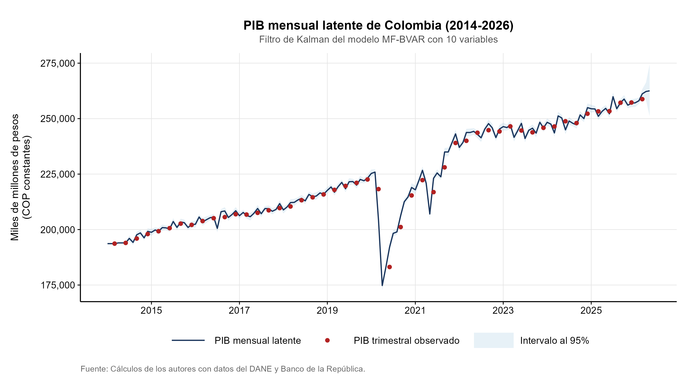
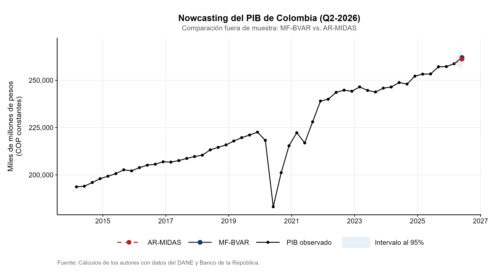

# Results and Figures: Nowcasting Colombian GDP

## 1. Real-Time Forecast (Nowcast Q2-2026)

| Model | Estimated GDP (Billions COP) | Credible Interval (95%) | Quarter-on-Quarter Growth (QoQ) | Year-on-Year Growth (YoY) |
| :--- | :---: | :---: | :---: | :---: |
| **MF-BVAR** | **262,066.3** | [256,108.6 - 268,248.5] | **+1.27%** | **+3.43%** |
| **AR-MIDAS** | **261,220.0** | - | **+0.94%** | **+3.10%** |

---

## 3. Forecast Error Variance Decomposition (12-Month FEVD - GDP)

| Variable | Transmission Channel | Variance Contribution (%) | Cumulative Contribution (%) |
| :--- | :--- | :---: | :---: |
| **Economic Tracking Indicator (ISE)** | Aggregate economic activity | **23.06%** | 23.06% |
| **Monetary Policy Rate** | Monetary policy / Financial conditions | **16.83%** | 39.89% |
| **Consumer Confidence Index (ICC)** | Expectations and domestic demand | **14.45%** | 54.34% |
| **Unemployment Rate (TD)** | Labor market | **12.54%** | 66.88% |
| **Brent Oil Price** | External shock / Terms of trade | **11.04%** | 77.92% |
| **Industrial Production Index (IPI)** | Manufacturing sector | **7.82%** | 85.74% |
| **Exchange Rate (TRM)** | External sector and FX | **5.16%** | 90.90% |
| **Inflation (CPI)** | Consumer prices | **4.12%** | 95.02% |
| **Retail Trade Index (ICM)** | Retail commercial demand | **3.18%** | 98.20% |
| **Own Inertia / GDP Shock** | Latent autoregressive dynamics | **1.80%** | 100.00% |

---

## 4. Out-of-Sample Predictive Evaluation (Expanding Window: 8 Quarters)

| Model | $MAE$ | $MAPE$ (%) | $RMSFE$ | $RMSFE$ Ratio | Error Reduction |
| :--- | :---: | :---: | :---: | :---: | :---: |
| **MF-BVAR** | **1,924.6** | **0.76%** | **2,604.1** | **0.433** | **-56.7%** |
| **AR-MIDAS** | 5,533.2 | 2.19% | 6,020.6 | 1.000 | Baseline |

---

## 5. Official Figures

### Figure 1: Unobserved Monthly GDP vs Observed Quarterly GDP (2014-2026)

---

### Figure 2: Nowcast Comparison for Q2-2026 (MF-BVAR vs. AR-MIDAS)

