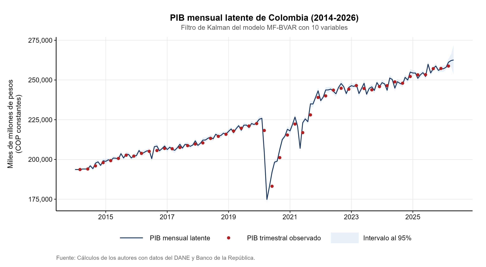

# Resultados y Gráficas: Nowcasting PIB Colombia

## 1. Pronóstico en Tiempo Real (Nowcast Q2-2026)

| Modelo | PIB Estimado (MM COP) | Intervalo de Credibilidad (95%) | Crecimiento Trimestral (t/t-1) | Crecimiento Anual (t/t-4) |
| :--- | :---: | :---: | :---: | :---: |
| **MF-BVAR** | **262,181.0** | [256,930.0 – 267,471.0] | **+1.31%** | **+3.48%** |
| **AR-MIDAS** | **263,172.0** | — | **+1.70%** | **+3.87%** |

---

## 2. Desagregación Mensual Latente del Nowcast (Q2-2026)

| Mes Proyectado | Mediana MF-BVAR (MM COP) | Límite Inferior (95%) | Límite Superior (95%) |
| :--- | :---: | :---: | :---: |
| **Abril 2026** | **86,458.1** | 84,950.0 | 87,950.0 |
| **Mayo 2026** | **86,862.3** | 85,050.0 | 88,600.0 |
| **Junio 2026** | **88,860.6** | 86,930.0 | 90,921.0 |
| **Total Q2-2026** | **262,181.0** | **256,930.0** | **267,471.0** |

---

## 3. Descomposición de Varianza del Error de Pronóstico (FEVD a 12 Meses - PIB)

| Variable | Tipo / Canal de Transmisión | Aporte a la Varianza (%) | Aporte Acumulado (%) |
| :--- | :--- | :---: | :---: |
| **Índice de Seguimiento a la Economía (ISE)** | Actividad económica agregada | **23.06%** | 23.06% |
| **Tasa de Intervención (BanRep)** | Política monetaria / Condiciones financieras | **16.83%** | 39.89% |
| **Índice de Confianza del Consumidor (ICC)** | Expectativas y demanda interna | **14.45%** | 54.34% |
| **Tasa de Desempleo (TD)** | Mercado laboral | **12.54%** | 66.88% |
| **Precio del Petróleo (Brent)** | Choque externo / Términos de intercambio | **11.04%** | 77.92% |
| **Índice de Producción Industrial (IPI)** | Sector manufacturero | **7.82%** | 85.74% |
| **Tasa Representativa del Mercado (TRM)** | Sector externo y cambiario | **5.16%** | 90.90% |
| **Inflación (IPC)** | Precios al consumidor | **4.12%** | 95.02% |
| **Índice de Comercio al por Menor (ICM)** | Demanda comercial minorista | **3.18%** | 98.20% |
| **Inercia Propia / Shock del PIB** | Dinámica autorregresiva latente | **1.80%** | 100.00% |

---

## 4. Evaluación Predictiva Fuera de Muestra (Benchmark Q1-2026: 258,780.7 MM)

| Modelo | Pronóstico (MM COP) | Error ($FE$) | $MAPE$ (%) | $RMSFE$ | Ratio $RMSFE$ | Reducción de Error |
| :--- | :---: | :---: | :---: | :---: | :---: | :---: |
| **MF-BVAR** | 260,392.7 | +1,612.0 | **0.62%** | **1,612.0** | **0.380** | **-62.0%** |
| **AR-MIDAS** | 263,026.1 | +4,245.4 | 1.64% | 4,245.4 | 1.000 | Baseline |

---

## 5. Gráficas Oficiales

### Figura 1: PIB Mensual Latente y PIB Trimestral Observado (2014–2026)

---

### Figura 2: Comparación de Nowcasts para Q2-2026 (MF-BVAR vs. AR-MIDAS)

